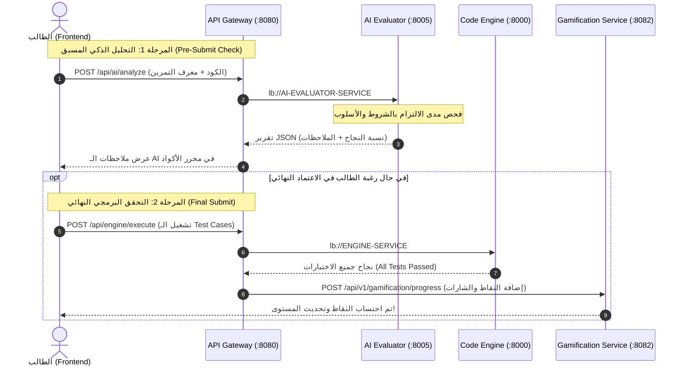

# 🧠 خطة المعمارية والتدريب: خدمة التقييم الذكي (AI Evaluator Service)
## منصة CodeTree V2

---

## 1. نظرة عامة والهدف المعماري (Overview & Objective)

الهدف من هذه الخدمة هو ترقية منصة **CodeTree** إلى **نظام تدريس ذكي (Intelligent Tutoring System - ITS)**، بحيث لا يقتصر التحقق من الحل على مجرد النجاح في الـ Unit Tests فقط (كما في منصات LeetCode التقليدية)، بل يقوم **Agent ذكاء اصطناعي** بتحليل جودة الكود، والتأكد من التزام الطالب بالمفاهيم البرمجية والشروط المفروضة (مثل: استخدام Recursion، منع الحلقات التكرارية، احترام التعقيد الزمني والمكاني O(N)، واتباع أسلوب الكود النظيف) **قبل اعتماد الإرسال النهائي (Final Submit) واحتساب النقاط**.

---

## 2. المعمارية وتدفق البيانات (System Architecture & Flow)

### موقع الخدمة في النظام:
* **اسم الخدمة:** `ai-evaluator-service`
* **المسار في Gateway:** `/api/ai/**` $\rightarrow$ `lb://AI-EVALUATOR-SERVICE`
* **المنفذ الافتراضي:** `8005`
* **التقنية:** Python 3.11 + FastAPI + PyTorch / Hugging Face Transformers
* **سجل الخدمات:** مسجلة كـ Eureka Client للتكامل مع باقي الخدمات.

### مخطط التسلسل الكامل (Sequence Diagram):



---

## 3. اختيار النموذج وتقنية التدريب (Model & Fine-Tuning Strategy)

### النموذج الأساسي الموصى به (Base Model):
* **الاسم:** `Qwen/Qwen2.5-Coder-1.5B-Instruct` أو `deepseek-ai/deepseek-coder-1.3b-instruct`.
* **الخصائص:**
  * خفيف الحجم (أقل من 3 جيجابايت في الذاكرة بعد الـ Quantization).
  * فائق الذكاء في فهم واستيعاب بنية الأكواد البرمجية.
  * يمكن تشغيله وتدريبه بسهولة وبالمجان عبر **Google Colab (T4 GPU)**.

### طريقة التدريب (Fine-Tuning Method):
* **QLoRA (Quantized Low-Rank Adaptation):** تدريب 1% فقط من الأوزان بصيغة 4-bit، مما يوفر سرعة عالية واستهلاكاً ضئيلاً للموارد.
* **الأداة المقترحة:** مكتبة **`Unsloth`** لتسريع التدريب بنسبة 5x وتوفير 80% من استهلاك ذاكرة كرت الشاشة (VRAM).

---

## 4. تجهيز البيانات (Data Preparation Strategy)

### الطريقة الأسرع والأفضل: توليد بيانات مخصصة (Synthetic Data Generation)
نظراً لأن منصتك تتطلب مخرجات دقيقة بتنسيق JSON محدد، نستخدم سكربت بايثون صغير مدعوم بنموذج قوي (مثل Gemini API أو DeepSeek) لتوليد 100 إلى 200 عينة متوافقة 100% مع شكل بيانات CodeTree.

#### شكل عينة التدريب (Training Sample Format):
```json
{
  "instruction": "أنت مرشد برمجي ذكي في منصة CodeTree. حلل كود الطالب التالي بناءً على شروط التمرين المحددة.",
  "input": {
    "exercise_title": "حساب متتالية فيبوناتشي",
    "required_concepts": ["Recursion", "Memoization"],
    "forbidden_constructs": ["while", "for"],
    "student_code": "def fib(n):\n    if n <= 1: return n\n    return fib(n-1) + fib(n-2)"
  },
  "output": {
    "passed_concepts": true,
    "concept_score": 80,
    "violations": [],
    "feedback": "الكود استخدم الاستدعاء الذاتي (Recursion) بنجاح، لكنه يفتقد للـ Memoization لحماية السيرفر من التعقيد الأسي O(2^N).",
    "coach_tips": "فكر في استخدام قاموس (Dict) أو المزيّن @lru_cache لحفظ النتائج المحسوبة مسبقاً."
  }
}
```

---

## 5. خطوات التدريب العملي في Google Colab (Training Script Blueprint)

```python
# كود مبسط للتدريب باستخدام Unsloth و QLoRA
from unsloth import FastLanguageModel
import torch
from trl import SFTTrainer
from transformers import TrainingArguments
from datasets import load_dataset

# 1. تحميل النموذج الأساسي بصيغة 4-bit
max_seq_length = 2048
model, tokenizer = FastLanguageModel.from_pretrained(
    model_name = "Qwen/Qwen2.5-Coder-1.5B-Instruct",
    max_seq_length = max_seq_length,
    load_in_4bit = True,
)

# 2. إعداد LoRA
model = FastLanguageModel.get_peft_model(
    model,
    r = 16,
    target_modules = ["q_proj", "k_proj", "v_proj", "o_proj", "gate_proj", "up_proj", "down_proj"],
    lora_alpha = 16,
    lora_dropout = 0,
    bias = "none",
)

# 3. إعداد التدريب
trainer = SFTTrainer(
    model = model,
    tokenizer = tokenizer,
    train_dataset = load_dataset("json", data_files="codetree_dataset.json", split="train"),
    dataset_text_field = "text",
    max_seq_length = max_seq_length,
    args = TrainingArguments(
        per_device_train_batch_size = 2,
        gradient_accumulation_steps = 4,
        warmup_steps = 10,
        max_steps = 60,
        learning_rate = 2e-4,
        fp16 = not torch.cuda.is_bf16_supported(),
        bf16 = torch.cuda.is_bf16_supported(),
        logging_steps = 1,
        output_dir = "outputs",
    ),
)

# 4. بدء التدريب وحفظ أوزان الـ LoRA
trainer.train()
model.save_pretrained_merged("codetree_ai_model", tokenizer, save_method="merged_16bit")
```

---

## 6. بناء الخدمة المصغرة (FastAPI Microservice Implementation)

المجلد: `c:\Users\mouka\OneDrive\Bureau\Code-Tree\ai-evaluator-service`

### ملف `main.py`:
```python
from fastapi import FastAPI
from pydantic import BaseModel
import py_eureka_client.eureka_client as eureka_client
import torch
from transformers import AutoTokenizer, AutoModelForCausalLM

app = FastAPI(title="CodeTree AI Evaluator")

# إعداد التسجيل في Eureka
@app.on_event("startup")
async def startup_event():
    await eureka_client.init_async(
        eureka_server="http://localhost:8761/eureka/",
        app_name="AI-EVALUATOR-SERVICE",
        instance_port=8005
    )
    # تحميل النموذج المدرب في الذاكرة
    global tokenizer, model
    tokenizer = AutoTokenizer.from_pretrained("./model")
    model = AutoModelForCausalLM.from_pretrained("./model", torch_dtype=torch.float16, device_map="auto")

class EvaluationRequest(BaseModel):
    exercise_title: str
    required_concepts: list[str]
    code: str

@app.post("/api/ai/analyze")
async def analyze_code(req: EvaluationRequest):
    # تجهيز الـ Prompt واستدعاء النموذج
    prompt = f"حلل كود الطالب للتمرين: {req.exercise_title}. الشروط: {req.required_concepts}. الكود: {req.code}"
    inputs = tokenizer(prompt, return_tensors="pt").to("cuda" if torch.cuda.is_available() else "cpu")
    outputs = model.generate(**inputs, max_new_tokens=256)
    result = tokenizer.decode(outputs[0], skip_special_tokens=True)
    return {"analysis": result}
```

---

## 7. الربط مع الـ API Gateway والتشغيل

### إضافة المسار في `gateway-service/src/main/resources/application.yml`:
```yaml
        - id: ai-evaluator-service
          uri: lb://AI-EVALUATOR-SERVICE
          predicates:
            - Path=/api/ai/**
```

### إضافته لملف `start-all.bat`:
```bat
start "AI Evaluator Service" cmd /k "cd ai-evaluator-service && uvicorn main:app --port 8005 --reload"
```

---

## 8. دورة التعلم والتطوير المستمر (Continual Learning Loop)

* **أثناء التشغيل اليومي:** أوزان النموذج تكون **مجمدة (Frozen)** لضمان السرعة والأمان وحماية الموديل من الأكواد الخاطئة والتخريب.
* **جمع البيانات:** يتم حفظ كل كود مع تقييم الـ AI ورد فعل الطالب (أزرار 👍 / 👎) في قاعدة البيانات.
* **إعادة التدريب الدوري (Monthly Retraining):** في نهاية كل شهر، يتم جمع أفضل الحالات الجديدة وتدريب النموذج عليها لمدة 15 دقيقة، واستبدال ملف الأوزان بسلاسة دون توقف المنصة.

---

## 9. قائمة المهام المرحلية للبدء (Execution Checklist)

- [ ] **المرحلة 1:** إنشاء سكربت توليد البيانات (`generate_dataset.py`) بـ 50 إلى 100 عينة متوافقة مع تمارين منصتك.
- [ ] **المرحلة 2:** تشغيل نوت بوك التدريب في Google Colab وتحميل أوزان الموديل الناتجة.
- [ ] **المرحلة 3:** إنشاء مجلد `ai-evaluator-service` وتجهيز ملف `main.py` وربطه مع Eureka.
- [ ] **المرحلة 4:** تحديث إعدادات `gateway-service` وإضافة زر "AI Review" في الـ Frontend (React Monaco Editor).
